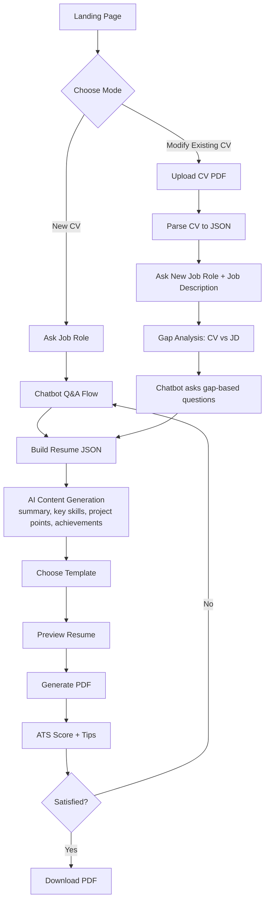
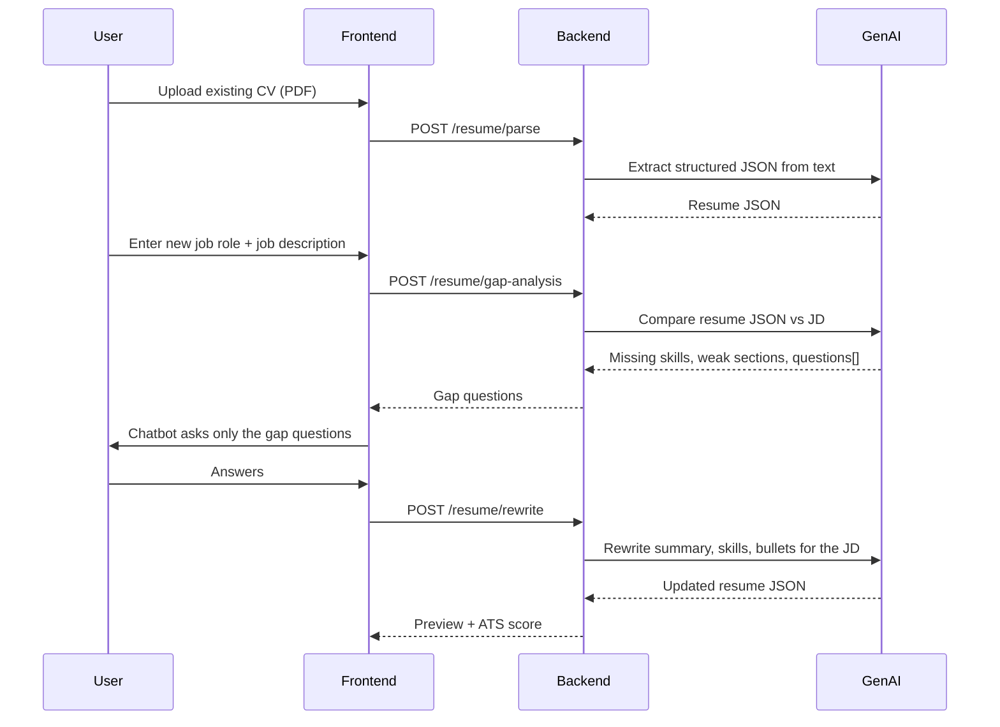

# 🤖 AI Resume Builder Chatbot

A conversational resume builder. Instead of filling a long form, the user **talks to a chatbot** that asks the right questions, uses GenAI to write the content, generates a **professional PDF CV**, and shows an **ATS score**.

---

## 1. Problem & Goal

| Problem | Solution |
|---|---|
| Resume forms are boring and users don't know what to write | A guided chatbot asks one question at a time |
| Project/achievement descriptions are weak | GenAI writes key-point descriptions |
| Resumes are not tailored to a job | Role + JD based gap questions |
| Users don't know if their CV passes ATS | ATS score + improvement tips |

**Goal:** a user finishes a role-targeted, ATS-friendly PDF resume in under 10 minutes.

---

## 2. Features

- ✅ Two modes: **Create New CV** / **Modify Existing CV**
- ✅ Chat interface with quick-reply buttons (`Done`, `Add more`, `Skip`)
- ✅ Two question types: **Basic (structured)** and **AI-generated (smart)**
- ✅ Auto-generated: key skills, project key points, achievements, professional summary
- ✅ Certificates and internships saved with links
- ✅ PDF export
- ✅ ATS score with suggestions
- ✅ Multiple CV templates (start with 1)

---

## 3. High-Level Workflow



---

## 4. Mode A — Create New CV

### Step 0: Job Role
Bot: *"Which job role are you targeting?"* (e.g., Data Analyst, MIS Executive, Full-Stack Developer)
The role is stored and used to steer every later AI question and generation.

### Step 1: Personal Details (Basic questions)
Name, city/address, phone, email, LinkedIn, GitHub, portfolio.

### Step 2: Education (Basic questions, repeatable)

Asked in this order, each with **`Add more` / `Done`** buttons:

| Level | Fields |
|---|---|
| Secondary (Class X) | School name, board, duration (from–to year), percentage |
| Higher Secondary (Class XII) | School name, board, stream, duration, percentage |
| College / University | Institute, degree, branch, duration, CGPA |

> Any level can be skipped. `Add more` allows extra entries (e.g., diploma, master's).

### Step 3: Technical Skills (Basic + chips)
Grouped input: Programming Languages, Libraries/Frameworks, Tools & Platforms, Databases, Others.
UI uses **suggestion chips** based on the job role (e.g., Data Analyst → SQL, Power BI, Excel).

### Step 4: Key Skills (Auto-generated)
AI generates soft/core skills from the job role + education + projects. User can edit/remove.

### Step 5: Projects (Basic + AI)
For each project the user gives: **title, tech stack, duration, GitHub/live link, one-line idea**.
AI then writes **3–4 key-point bullets** (action verb + what + result), and asks for any missing numbers (e.g., "How many rows or users?") to make bullets measurable.
Buttons: `Add another project` / `Done`.

### Step 6: Internships & Certificates
- Internship: company, role, duration, **link** (certificate/offer letter)
- Certificate: name, issuer, **link**
- Both repeatable with `Add more` / `Done`.

### Step 7: Attachments / Achievements
- If the user adds achievements → use them.
- If the user gives nothing → **AI auto-generates** achievements from projects, certificates and internships (only from provided facts, no fabrication).

### Step 8: Professional Summary (Auto-generated, shown at top)
Generated **last**, using all collected data + job role, then placed at the **front** of the CV.

### Step 9: Template → Preview → PDF → ATS Score

---

## 5. Mode B — Modify Existing CV



**Gap analysis checks**
1. Required skills in JD that are missing from the CV
2. Projects that don't show relevant tools/results
3. Missing sections (certificates, internship, links)
4. Weak/unmeasurable bullets
5. Keywords in JD not present in the CV

**Example gap questions** (Data Analyst JD asks for Tableau + stakeholder reporting):
- "The JD asks for stakeholder reporting. Did you present dashboards to anyone?"
- "Your Pizza Sales project uses Power BI. Did you also use SQL window functions?"

---

## 6. Chatbot Design

### Question types

| Type | Source | Example |
|---|---|---|
| **Basic** | Fixed schema, deterministic | "Enter your college name" |
| **Smart** | LLM, based on role / JD / gaps | "Which KPIs did you track in this project?" |

### Conversation state machine

```
START → MODE_SELECT → ROLE → PERSONAL → EDUCATION(loop) → SKILLS
      → KEY_SKILLS(auto) → PROJECTS(loop) → INTERNSHIP(loop) → CERTS(loop)
      → ACHIEVEMENTS(auto if empty) → SUMMARY(auto) → TEMPLATE → PREVIEW → PDF → ATS
```

Each state has: `prompt`, `validator`, `next`, and optional `ai_followup`.
Basic states are **code-driven** (reliable, cheap); only generation and gap questions call the LLM.

### UI components
- Message bubbles + typing indicator
- Quick-reply buttons: `Done`, `Add more`, `Skip`, `Edit previous`
- Progress bar (Education → Skills → Projects → …)
- Live resume preview panel (right side on desktop)
- Edit any section at any time

---

## 7. Data Model (Resume JSON)

```json
{
  "jobRole": "Data Analyst",
  "personal": {
    "name": "", "location": "", "phone": "", "email": "",
    "linkedin": "", "github": "", "portfolio": ""
  },
  "summary": "",
  "education": [
    { "level": "secondary|higher_secondary|college",
      "institute": "", "board": "", "degree": "", "stream": "",
      "from": "", "to": "", "score": "", "scoreType": "percentage|cgpa" }
  ],
  "technicalSkills": { "languages": [], "libraries": [], "tools": [], "visualization": [], "others": [] },
  "keySkills": [],
  "projects": [
    { "title": "", "techStack": [], "from": "", "to": "", "link": "",
      "bullets": [] }
  ],
  "internships": [ { "title": "", "company": "", "from": "", "to": "", "link": "" } ],
  "certificates": [ { "name": "", "issuer": "", "link": "" } ],
  "achievements": [],
  "languages": [ { "name": "", "level": "" } ],
  "template": "classic"
}
```

---

## 8. AI Design

### Where GenAI is used

| Task | Input | Output |
|---|---|---|
| Key skills | role, skills, projects | 6–8 skills |
| Project bullets | title, stack, user notes | 3–4 action-verb bullets |
| Achievements | projects, certs, internships | 2–3 factual lines |
| Summary | whole resume JSON + role | 3–4 line intro |
| CV parsing | PDF text | Resume JSON |
| Gap analysis | resume JSON + JD | gaps + questions |

### Prompt rules (important)
1. **Never invent facts.** Use only user-supplied data; if numbers are missing, ask.
2. Output **strict JSON** so the app can render it.
3. Start bullets with strong verbs, keep to one line, include a metric when available.
4. Use keywords from the job role/JD naturally (no keyword stuffing).

**Example prompt (project bullets)**
```
You are a resume writer. Job role: {{jobRole}}.
Project: {{title}} | Stack: {{techStack}} | Notes: {{userNotes}}
Write 3-4 resume bullets. Rules: start with an action verb, max 25 words,
use only facts given, include metrics only if provided.
Return JSON: {"bullets": ["...", "..."]}
```

---

## 9. ATS Score Design

Score out of **100**, computed mostly by deterministic rules (+ LLM for relevance).

| Category | Weight | How it's checked |
|---|---|---|
| Keyword match (role / JD) | 30 | % of important keywords present |
| Section completeness | 20 | Summary, skills, education, projects, contact present |
| Measurable impact | 15 | Bullets with numbers / % / counts |
| Formatting & parsability | 15 | Single column, standard headings, selectable text, no images/tables for core text |
| Contact & links | 10 | Email, phone, LinkedIn, GitHub valid |
| Length & readability | 10 | 1 page (fresher), bullet length, no spelling errors |

**Output shown to user**
- Score ring (e.g., 82/100)
- ✅ What's good, ⚠️ What to fix (e.g., "Add SQL to skills", "Quantify Spotify project")
- `Improve with AI` button → loops back to chatbot with targeted questions

---

## 10. Templates

- v1: **Classic ATS** (single column, clean headings — matches the reference resume layout)
- Later: Modern, Minimal, Two-column (flag lower ATS compatibility)

Templates are **HTML/CSS components** that take the Resume JSON, so adding a template = adding one component.

---

## 11. Suggested Tech Stack

| Layer | Choice |
|---|---|
| Frontend | Next.js + React, Tailwind CSS |
| Chat state | Zustand / React Context + state machine (XState optional) |
| Backend | Next.js API routes or FastAPI |
| AI | LLM API (Claude / other) with JSON output |
| PDF parse | `pdf-parse` / `pdfplumber` |
| PDF generate | Puppeteer (HTML → PDF) or `@react-pdf/renderer` |
| Database | PostgreSQL / MongoDB (users, resumes, versions) |
| Auth | NextAuth / Clerk |
| Storage | S3 / Cloudinary (uploaded + generated PDFs) |
| Deploy | Vercel + managed DB |

---

## 12. API Endpoints

| Method | Endpoint | Purpose |
|---|---|---|
| POST | `/api/session` | Start session (mode: new / modify) |
| POST | `/api/chat` | Send user message, get next bot question |
| POST | `/api/resume/parse` | Upload PDF → Resume JSON |
| POST | `/api/resume/gap-analysis` | Resume + JD → gaps & questions |
| POST | `/api/ai/generate` | Summary / key skills / bullets / achievements |
| POST | `/api/resume/pdf` | Resume JSON + template → PDF |
| POST | `/api/resume/ats` | Resume JSON (+ JD) → ATS score |
| GET | `/api/resumes` | List user's saved resumes |

---

## 13. Folder Structure

```
ai-resume-builder-chatbot/
├── app/
│   ├── page.tsx                  # Landing + mode select
│   ├── chat/page.tsx             # Chatbot + live preview
│   └── api/                      # Endpoints above
├── components/
│   ├── chat/                     # Bubble, QuickReplies, ProgressBar
│   ├── preview/                  # ResumePreview
│   └── templates/                # ClassicTemplate, ModernTemplate...
├── lib/
│   ├── flow/                     # State machine + question definitions
│   ├── ai/                       # Prompts + JSON validators
│   ├── ats/                      # Scoring rules
│   ├── parser/                   # PDF → text → JSON
│   └── pdf/                      # PDF generation
├── types/resume.ts
├── .env.example
└── README.md
```

---

## 14. Edge Cases & Safety

- User skips a section → omit it, don't leave empty headings
- Fresher with no internship/achievements → AI generates achievements from real data only
- Scanned/image PDF upload → OCR fallback or ask user to re-upload
- LLM returns invalid JSON → retry once, then fall back to manual input
- Never store phone/email in logs; allow users to delete their resumes
- Rate-limit AI endpoints

---

## 15. Development Roadmap

| Phase | Scope |
|---|---|
| **MVP (Week 1–2)** | Mode A chat flow, basic questions, Classic template, PDF export |
| **Phase 2 (Week 3)** | AI generation: key skills, project bullets, summary, achievements |
| **Phase 3 (Week 4)** | ATS score + suggestions |
| **Phase 4 (Week 5)** | Mode B: upload, parse, JD gap analysis |
| **Phase 5** | Multiple templates, auth, saved resumes, versioning |
| **Future** | Cover letter generator, LinkedIn import, mock-interview questions from the CV |

---

## 16. Getting Started

```bash
git clone https://github.com/<your-username>/ai-resume-builder-chatbot.git
cd ai-resume-builder-chatbot
npm install
cp .env.example .env.local   # add your LLM API key and DB URL
npm run dev
```

`.env.example`
```
LLM_API_KEY=
DATABASE_URL=
NEXTAUTH_SECRET=
```

---

## 17. Author

**Nabamit Dutta** — [GitHub](https://github.com/Nabamit) · [Portfolio](https://nabamit.dev)
